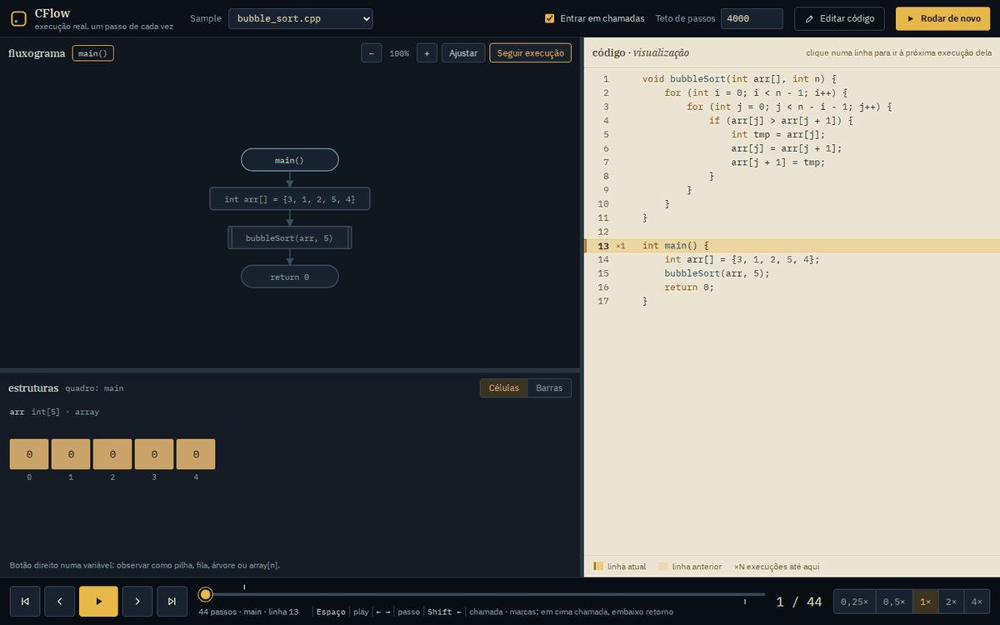
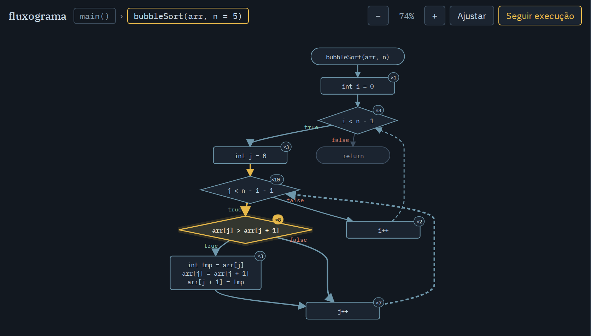
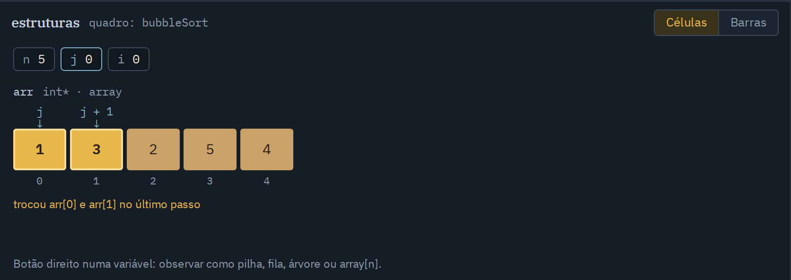
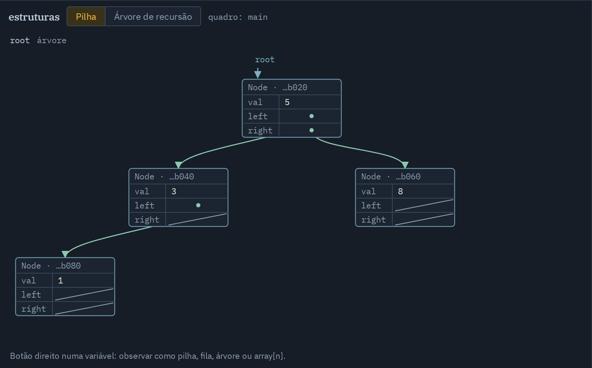
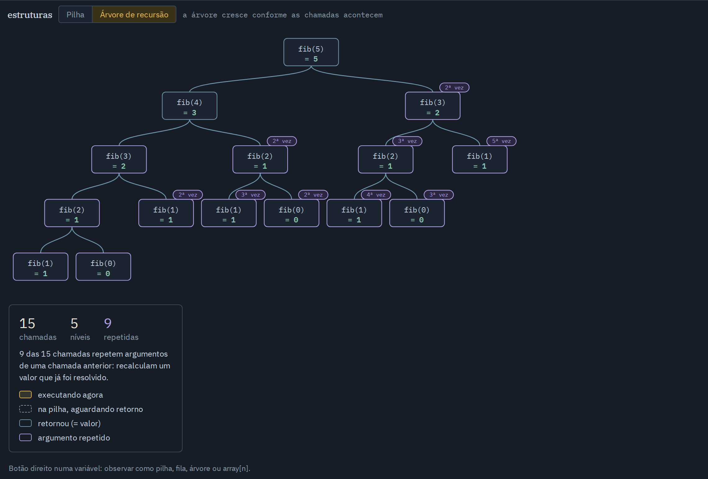
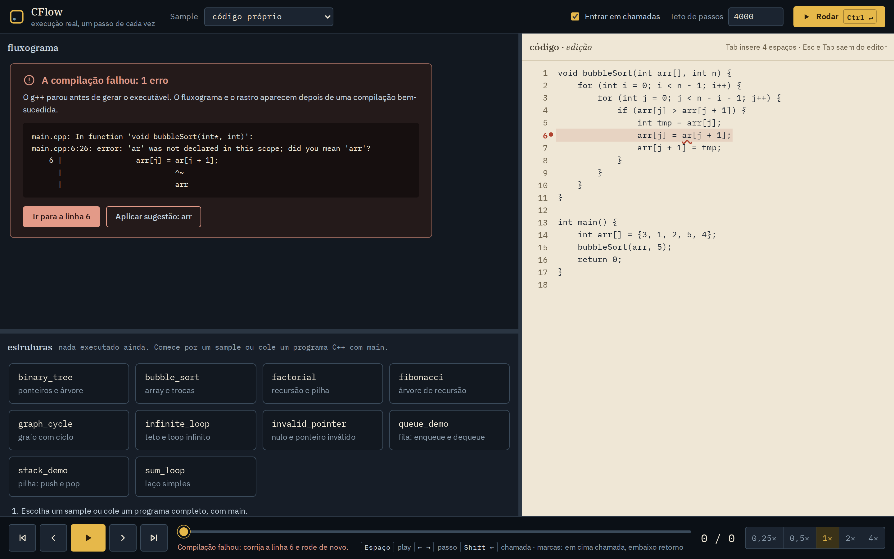
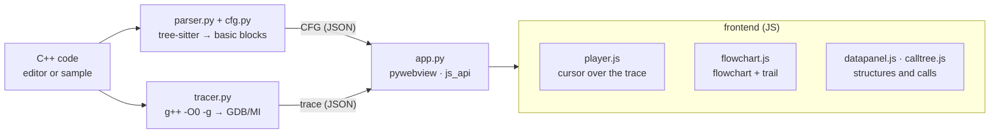

# CFlow

**English** · [Português](README.pt-BR.md)

**Real C++ execution, step by step, as a flowchart.**

[](https://github.com/MarceloPanho/CFlow/actions/workflows/ci.yml)




## Why

Debuggers show state: variables, stack, memory. What they don't show is *flow*: which path the program took to get there. Teaching visualizers show flow, but they usually simulate execution, and the simulation drifts from the real program in exactly the interesting cases.

CFlow compiles your program with `-O0 -g`, runs it under real GDB and records every step. The flowchart lights up the path taken, the code follows the current line, and the data structures change in the same step. What you see is what the program did.

## Features

| | |
|---|---|
|  |  |
| **Flowchart with a trail.** The current node in amber, the path thickening with every pass, ×N visits per node, zoom, and a camera that follows execution. | **Arrays with index markers.** `j` and `j + 1` come from the `arr[...]` expressions in the code; swaps animate both cells; bar mode for sorting. |
|  |  |
| **Box-and-pointer.** Each node is a table of fields, each pointer leaves from its own field, the layout doesn't jump between steps, and new nodes are marked. | **Recursion tree.** One box per call with its return value; repeated calls are highlighted, which makes the cost of naive Fibonacci visible. |

- **Infinite loops:** execution hits the step cap, keeps animating, and the banner says whether the loop is *likely* or *proven* (whole state repeated).
- **Null and invalid pointers:** null is drawn as a stopped line; an unreadable address becomes a dashed arrow to a red target, without breaking the traversal.
- **Watch as:** right-click a variable to treat it as a stack, queue, tree, graph or `array[n]`.
- **Compile errors in place:** a dot in the margin, a squiggle at the column, a translated message, and "apply suggestion" when g++ suggests a name.



The app's interface is in Portuguese.

## How it works



**The trace is the contract.** The engine (Python) never draws and the frontend (JS) never talks to GDB: they only exchange serializable JSON. Each trace step carries the line, the stack frame and the state of the variables:

```json
{
  "i": 22, "line": 3, "func": "bubbleSort", "event": "line", "frame_id": 2,
  "scalars": { "n": 5, "i": 0, "j": 3 },
  "structures": {
    "arr": { "kind": "array", "values": [1, 2, 3, 4, 5],
             "indices": [{ "expr": "j", "value": 3 }, { "expr": "j + 1", "value": 4 }] }
  },
  "call_stack": [{ "func": "main", "frame_id": 1 }, { "func": "bubbleSort", "frame_id": 2, "args": { "n": 5 } }]
}
```

Pointer structures use `kind: "tree"`/`"graph"` with `nodes` (`addr` + fields) and `edges` (`to` is an address, `null` or `"invalid"`). The schema only grows additively. Decisions and phases live in [PLAN.md](PLAN.md) and the [design document](docs/design-debugger-visual-cpp.md) (both in Portuguese).

## Installation

Requirements: Python 3.10+, `g++` and `gdb` on `PATH`, and on Linux, GTK + WebKit for the `pywebview` window.

**Debian / Ubuntu**

```bash
sudo apt install g++ gdb python3-venv python3-gi gir1.2-webkit2-4.1
python3 -m venv --system-site-packages .venv
.venv/bin/pip install -r requirements.txt
```

**Arch**

```bash
sudo pacman -S gcc gdb python python-gobject webkit2gtk-4.1
python -m venv --system-site-packages .venv
.venv/bin/pip install -r requirements.txt
```

**Windows (MSYS2 / MinGW-w64)**

Install [MSYS2](https://www.msys2.org/) and, in the UCRT64 terminal:

```bash
pacman -S mingw-w64-ucrt-x86_64-gcc mingw-w64-ucrt-x86_64-gdb
```

Add `C:\msys64\ucrt64\bin` to `PATH` (CFlow also looks there) and, in PowerShell:

```powershell
py -m venv .venv
.venv\Scripts\pip install -r requirements.txt
```

Always use MinGW (`g++`/`gdb`), never MSVC: GDB can't drive `cl.exe` binaries.

> On Linux the venv needs `--system-site-packages` to see the system's PyGObject. The `python` command often doesn't exist: use `python3` or the venv's interpreter. If the system Python gets upgraded, recreate the venv.

## Usage

```bash
.venv/bin/python -m engine        # Windows: .venv\Scripts\python -m engine
```

1. Pick a sample or paste a complete C++ program with `main`.
2. Set the **step cap** and whether the debugger **steps into calls**.
3. Click **Rodar** (run) or press `Ctrl+Enter`. The engine compiles with `-O0 -g`, runs it under GDB and delivers CFG + trace.
4. Move through the execution with the timeline, the keyboard, or by clicking a line of code (jumps to its next execution).

| Key | Action |
|---|---|
| `Space` | play and pause |
| `←` `→` | previous and next step |
| `Shift` + `←` `→` | previous and next call or return |
| `Home` `End` | start and end of the execution |
| `+` `−` `0` | zoom and fit the flowchart |
| `Ctrl` + `Enter` | run the code in the editor |

The **step cap** bounds long or infinite executions: when it's reached, CFlow still shows everything it recorded.

## Samples

| File | What it shows | Visual feature |
|---|---|---|
| `bubble_sort.cpp` | in-place sorting | array with `j`/`j + 1` markers, animated swap, bar mode |
| `fibonacci.cpp` | naive double recursion | recursion tree with repeated calls |
| `factorial.cpp` | simple recursion | call trail growing and unwinding |
| `binary_tree.cpp` | binary search tree insertion | box-and-pointer tree, new node, null pointer |
| `graph_cycle.cpp` | stack structs linked in a cycle | graph with one node per address, pointer `p` walking it |
| `stack_demo.cpp` | `std::stack` | stack with push and pop |
| `queue_demo.cpp` | `std::queue` | queue with front and back |
| `infinite_loop.cpp` | a loop that never ends | step cap and loop banner |
| `invalid_pointer.cpp` | pointer to a variable, null and unreadable | null stopper and invalid target |
| `sum_loop.cpp` | simple loop | trail and visit counters |

## Known limitations

- `-O0 -g` only: with optimization, GDB's line no longer matches the flowchart.
- No `goto` or exceptions (`try`/`catch`/`throw`) in the flowchart.
- A dangling pointer that still points to readable memory goes unnoticed; only unreadable addresses become "invalid".
- Tracing is slow: about half a second per step through GDB (bubble sort's 44 steps take ~25 s). Long executions also stop at the step cap.
- When you click an earlier frame in the call trail, the values shown are from the last step that frame executed.

## Development

```
engine/      engine: parser.py, cfg.py, tracer.py, trace.py (schema), app.py (pywebview host)
frontend/    index.html, css/, js/ (player, flowchart, datapanel, calltree, code, app) and vendor/
samples/     sample C++ programs, also used as living tests
tests/       pytest: engine, CFG and UI (Playwright); fixtures/ holds recorded traces
tools/       capture.py: visual harness and README image generator
docs/        design and docs/img/ (generated, don't edit by hand)
```

```bash
.venv/bin/pip install -r requirements.txt
.venv/bin/python -m playwright install chromium

.venv/bin/pytest -q                              # engine + UI
.venv/bin/python tools/capture.py record         # re-record sample traces into tests/fixtures/
.venv/bin/python tools/capture.py shots          # screenshots + checks (label outside its shape, node out of view, console error)
.venv/bin/python tools/capture.py docs           # regenerate docs/img/ and the README GIF
```

README images always come from the harness, never from manual screenshots. Rules for contributors (details in [CLAUDE.md](CLAUDE.md)):

- The trace is the contract: extend the schema additively; the engine doesn't draw and the frontend doesn't talk to GDB.
- When extending: schema first, then the tracer, then the renderer.
- Always `-O0 -g`. No hardcoded paths or binary names: the toolchain goes through `discover_toolchain()` and `pathlib`.
- Work in vertical slices, each running end to end and committable on its own.

Per-platform packaging (no cross-compiling): `.venv/bin/pyinstaller pack/cflow.spec`.

## Roadmap

- `goto` and exceptions in the flowchart.
- Several functions on screen at once; function pointers and virtual methods.
- An input form that generates `main` for simple types.
- Windowing or sampling of the trace for long executions.
- A heuristic for trees with parent pointers.
- ASan integration for precise dangling and use-after-free detection.

## License and authorship

[MIT](LICENSE) © 2026 Marcelo Panho.
