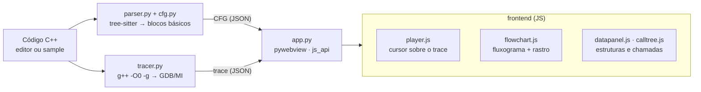

# CFlow

[English](README.md) · **Português**

**Execução real de C++, passo a passo, como fluxograma.**

[](https://github.com/MarceloPanho/CFlow/actions/workflows/ci.yml)


## Por quê

Depuradores mostram o estado: variáveis, pilha, memória. O que eles não mostram é o *fluxo*, isto é, por qual caminho o programa andou para chegar ali. Visualizadores didáticos mostram o fluxo, mas costumam simular a execução, e a simulação diverge do programa de verdade justamente nos casos interessantes.

O CFlow compila o seu programa com `-O0 -g`, roda no GDB de verdade e grava cada passo. O fluxograma acende o caminho percorrido, o código acompanha a linha e as estruturas de dados mudam no mesmo passo. O que aparece na tela é o que o programa fez.

## Recursos

| | |
|---|---|
|  |  |
| **Fluxograma com rastro.** O nó atual em âmbar, o caminho percorrido mais espesso a cada volta, ×N visitas por nó, zoom e câmera que segue a execução. | **Arrays com marcadores.** `j` e `j + 1` vêm das expressões `arr[...]` do código; a troca anima as duas células; modo barras para ordenação. |
|  |  |
| **Box-and-pointer.** Cada nó é uma tabela de campos, cada ponteiro sai do próprio campo, o layout não salta entre passos e o nó novo aparece marcado. | **Árvore de recursão.** Uma caixa por chamada com o valor de retorno; chamadas repetidas aparecem destacadas, o que mostra o custo do Fibonacci ingênuo. |

- **Loop infinito:** a execução bate no teto de passos, continua animando e o aviso diz se o loop é *provável* ou *comprovado* (estado inteiro repetido).
- **Ponteiro nulo e inválido:** nulo vira um traço com batente; endereço ilegível vira uma seta tracejada até um alvo vermelho, sem derrubar a travessia.
- **Observar como:** botão direito numa variável para tratá-la como pilha, fila, árvore, grafo ou `array[n]`.
- **Erro de compilação no lugar certo:** ponto na margem, sublinhado na coluna, mensagem traduzida e "Aplicar sugestão" quando o g++ sugere um nome.


## Como funciona



**O trace é o contrato.** O motor (Python) nunca desenha e o frontend (JS) nunca fala com o GDB: os dois só trocam JSON serializável. Cada passo do trace carrega a linha, o quadro de pilha e o estado das variáveis:

```json
{
  "i": 22, "line": 3, "func": "bubbleSort", "event": "line", "frame_id": 2,
  "scalars": { "n": 5, "i": 0, "j": 3 },
  "structures": {
    "arr": { "kind": "array", "values": [1, 2, 3, 4, 5],
             "indices": [{ "expr": "j", "value": 3 }, { "expr": "j + 1", "value": 4 }] }
  },
  "call_stack": [{ "func": "main", "frame_id": 1 }, { "func": "bubbleSort", "frame_id": 2, "args": { "n": 5 } }]
}
```

Estruturas de ponteiro usam `kind: "tree"`/`"graph"` com `nodes` (`addr` + campos) e `edges` (`to` é um endereço, `null` ou `"invalid"`). O schema só cresce de forma aditiva. Decisões e fases estão no [PLAN.md](PLAN.md) e no [documento de design](docs/design-debugger-visual-cpp.md).

## Instalação

Requisitos: Python 3.10+, `g++` e `gdb` no `PATH` e, no Linux, GTK + WebKit para a janela do `pywebview`.

**Debian / Ubuntu**

```bash
sudo apt install g++ gdb python3-venv python3-gi gir1.2-webkit2-4.1
python3 -m venv --system-site-packages .venv
.venv/bin/pip install -r requirements.txt
```

**Arch**

```bash
sudo pacman -S gcc gdb python python-gobject webkit2gtk-4.1
python -m venv --system-site-packages .venv
.venv/bin/pip install -r requirements.txt
```

**Windows (MSYS2 / MinGW-w64)**

Instale o [MSYS2](https://www.msys2.org/) e, no terminal UCRT64:

```bash
pacman -S mingw-w64-ucrt-x86_64-gcc mingw-w64-ucrt-x86_64-gdb
```

Coloque `C:\msys64\ucrt64\bin` no `PATH` (o CFlow também procura lá) e, no PowerShell:

```powershell
py -m venv .venv
.venv\Scripts\pip install -r requirements.txt
```

Use sempre o MinGW (`g++`/`gdb`), nunca o MSVC: o GDB não dirige binários do `cl.exe`.

> No Linux, o venv precisa de `--system-site-packages` para enxergar o PyGObject do sistema. O comando `python` muitas vezes não existe: use `python3` ou o interpretador do venv. Se o Python do sistema for atualizado, recrie o venv.

## Uso

```bash
.venv/bin/python -m engine        # Windows: .venv\Scripts\python -m engine
```

1. Escolha um sample ou cole um programa C++ completo, com `main`.
2. Ajuste o **teto de passos** e se o depurador **entra nas chamadas**.
3. Clique em **Rodar** (ou `Ctrl+Enter`). O motor compila com `-O0 -g`, roda no GDB e entrega CFG + trace.
4. Navegue pela execução com a timeline, o teclado ou clicando numa linha do código (vai para a próxima execução dela).

| Tecla | Ação |
|---|---|
| `Espaço` | reproduzir e pausar |
| `←` `→` | passo anterior e próximo |
| `Shift` + `←` `→` | chamada ou retorno anterior e próximo |
| `Home` `End` | início e fim da execução |
| `+` `−` `0` | zoom e ajustar o fluxograma à tela |
| `Ctrl` + `Enter` | rodar o código do editor |

O **teto de passos** limita execuções longas ou infinitas: ao atingi-lo, o CFlow ainda mostra tudo o que gravou.

## Samples

| Arquivo | O que demonstra | Recurso visual |
|---|---|---|
| `bubble_sort.cpp` | ordenação in-place | array com marcadores `j`/`j + 1`, troca animada, modo barras |
| `fibonacci.cpp` | recursão dupla ingênua | árvore de recursão com chamadas repetidas |
| `factorial.cpp` | recursão simples | trilha de chamadas crescendo e desempilhando |
| `binary_tree.cpp` | inserção em árvore binária de busca | box-and-pointer em árvore, nó novo, ponteiro nulo |
| `graph_cycle.cpp` | structs na pilha ligadas em ciclo | grafo com um nó por endereço, ponteiro `p` percorrendo |
| `stack_demo.cpp` | `std::stack` | pilha com push e pop |
| `queue_demo.cpp` | `std::queue` | fila com frente e fim |
| `infinite_loop.cpp` | laço que nunca termina | teto de passos e aviso de loop |
| `invalid_pointer.cpp` | ponteiro para variável, nulo e ilegível | batente de nulo e alvo inválido |
| `sum_loop.cpp` | laço simples | rastro e contador de visitas |

## Limitações conhecidas

- Só `-O0 -g`: com otimização, a linha do GDB não bate com o fluxograma.
- Sem `goto` nem exceções (`try`/`catch`/`throw`) no fluxograma.
- Ponteiro pendurado (*dangling*) que ainda aponta para memória legível passa despercebido; só endereços ilegíveis viram "inválido".
- O rastreamento é lento: cerca de meio segundo por passo pelo GDB (os 44 passos do bubble sort levam uns 25 s). Execuções longas também param no teto de passos.
- Ao clicar num quadro anterior na trilha de chamadas, os valores mostrados são os do último passo em que aquele quadro executou.

## Desenvolvimento

```
engine/      motor: parser.py, cfg.py, tracer.py, trace.py (schema), app.py (host pywebview)
frontend/    index.html, css/, js/ (player, flowchart, datapanel, calltree, code, app) e vendor/
samples/     programas C++ de exemplo, também usados como testes vivos
tests/       pytest: motor, CFG e UI (Playwright); fixtures/ com os traces gravados
tools/       capture.py: harness visual e gerador das imagens do README
docs/        design e docs/img/ (gerado, não editar à mão)
```

```bash
.venv/bin/pip install -r requirements.txt
.venv/bin/python -m playwright install chromium

.venv/bin/pytest -q                              # motor + UI
.venv/bin/python tools/capture.py record         # regrava os traces dos samples em tests/fixtures/
.venv/bin/python tools/capture.py shots          # capturas + checagens (rótulo fora da forma, nó fora da vista, erro no console)
.venv/bin/python tools/capture.py docs           # regenera docs/img/ e o GIF do README
```

As imagens do README saem sempre do harness, nunca de captura manual. Regras para contribuir (detalhes no [CLAUDE.md](CLAUDE.md)):

- O trace é o contrato: estenda o schema de forma aditiva; o motor não desenha e o frontend não fala com o GDB.
- Ao estender: primeiro o schema, depois o tracer, depois o renderer.
- Sempre `-O0 -g`. Nada de caminho ou nome de binário fixo: a toolchain passa por `discover_toolchain()` e `pathlib`.
- Trabalhe em fatias verticais, cada uma rodando de ponta a ponta e comitável sozinha.

Empacotamento por plataforma (sem cross-compile): `.venv/bin/pyinstaller pack/cflow.spec`.

## Roadmap

- `goto` e exceções no fluxograma.
- Várias funções na tela ao mesmo tempo; ponteiros de função e métodos virtuais.
- Formulário de entrada que gera um `main` para tipos simples.
- Janela ou amostragem do trace para execuções longas.
- Heurística para árvores com ponteiro para o pai.
- Integração com ASan para *dangling* e *use-after-free* precisos.

## Licença e autoria

[MIT](LICENSE) © 2026 Marcelo Panho.
